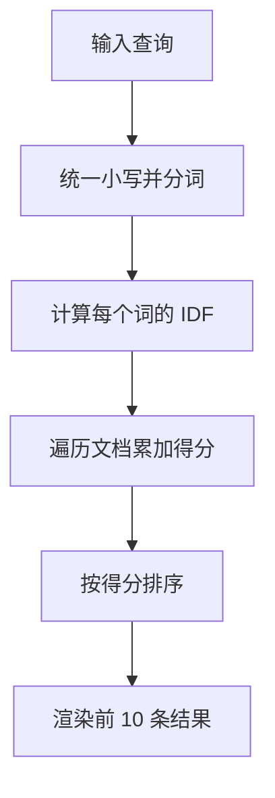

博客只有几十篇文章的时候，搜索是一个很容易被过度设计的功能。

大而全的方案通常长这样：接入 Algolia，配置索引，写一个同步脚本，处理额度、密钥和中文分词。它能支撑百万级内容，但对我来说，收益和复杂度完全不成比例。

所以我决定自己写一个：构建时生成 JSON 索引，浏览器里做打分和排序，整个脚本压缩后不到 3KB。

## 索引里放什么

每篇文章抽取五个字段：

```ts
type Doc = {
  slug: string;
  title: string;
  description: string;
  tags: string[];
  body: string;
  lang: 'zh' | 'en';
};
```

正文只保留前 2000 个字符。个人博客的文章通常不会在第五屏之后才出现关键信息，截断带来的召回损失可以接受，但索引体积会小很多。

## 打分：TF-IDF 的直觉

搜索的本质是排序。给定一个查询，我们要回答：哪篇文档最可能包含读者想要的东西。

TF-IDF 用两个信号回答这个问题：

- **TF**：某个词在文档里出现得越多，文档越可能和它相关；
- **IDF**：某个词在整个语料里越罕见，它的区分能力越强。

用公式表示：

$$
\mathrm{tf}(t, d) = \frac{f_{t,d}}{\sum_{t' \in d} f_{t',d}}
$$

$$
\mathrm{idf}(t) = \log\frac{N + 1}{\mathrm{df}(t) + 1} + 1
$$

$$
\mathrm{score}(q, d) = \sum_{t \in q} \mathrm{tf}(t, d) \cdot \mathrm{idf}(t)
$$

其中 $f_{t,d}$ 是词 $t$ 在文档 $d$ 中的出现次数，$\mathrm{df}(t)$ 是包含该词的文档数，$N$ 是文档总数。

加 1 是为了避免除零，也让从未出现过的词有一个平滑的权重。

## 中文怎么办

英文可以按空格切词，中文不行。完整的中文分词需要词典和模型，放在浏览器里太重了。

对于搜索场景，一个便宜且有效的近似是**二元切分**：把「静态博客」切成「静态」「态博」「博客」，查询和文档都按同样的方式处理。

```ts
function tokenize(text: string, lang: 'zh' | 'en') {
  const normalized = text.toLowerCase().replace(/\s+/g, ' ').trim();
  if (lang === 'en') {
    return normalized.match(/[a-z0-9']+/g) ?? [];
  }
  const chars = Array.from(normalized.replace(/[\s\p{P}]/gu, ''));
  const grams: string[] = [];
  for (let i = 0; i < chars.length - 1; i += 1) {
    grams.push(chars[i] + chars[i + 1]);
  }
  return grams;
}
```

二元切分会产生一些无意义的组合，但 TF-IDF 会自动压低它们的权重。对几十篇文章的规模来说，这个精度足够了。

## 查询时的流程



实现上，每次查询都会重新遍历全部文档。几十篇、每篇两千字，在现代设备上通常不到 10 毫秒，没有必要提前建倒排索引。

如果以后文章数量增长到几百篇，再考虑把倒排索引也放进构建产物。

## 那些被省掉的东西

- **没有高亮**：高亮需要处理 HTML 转义和片段截取，收益不高，先用标题和摘要足够了。
- **没有拼音搜索**：输入「souti」找不到「搜体」，这是已知限制。
- **没有模糊匹配**：拼写错误不会自动纠正，但个人博客的查询通常很短，误输入的代价很低。
- **没有服务端**：索引是一个静态 JSON 文件，可以被 CDN 缓存。

## 结果

搜索从一个「需要接第三方服务」的问题，变成了一个「构建时多生成一个文件」的问题。它不完美，但它足够快、足够小，而且完全可控。

有时候，功能的正确规模不是由行业标准决定的，而是由你实际拥有的内容量决定的。
